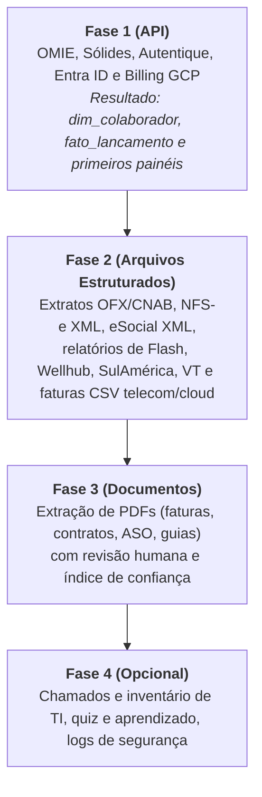

# Mapeamento de Ferramentas, Dados e Ingestão no BigQuery (RH/Financeiro)

> **Data:** 3 de novembro de 2026  
> **Autor:** @henrique  

---

## 1. Visão Geral e Premissas

Das cerca de 70 ferramentas mapeadas, poucas entregam dados por API; a maioria entrega arquivos (`CSV`, `XLSX`, `XML`, `OFX`) ou documentos (`PDF`, `DOCX`), e isso define como cada uma entra no BigQuery.

### Classificação de Maturidade de Ingestão
Usada na coluna *"Como chega"* das tabelas:

* **A – API:** dado estruturado (JSON) puxado por conector agendado.  
  *Ex.:* OMIE, Sólides, Autentique, Microsoft Graph.
* **B – Arquivo estruturado:** exportação periódica em `CSV`, `XLSX`, `XML`, `OFX` ou `CNAB`, que cai numa pasta e é carregada em lote.
* **C – Documento:** `PDF`, `DOCX` ou imagem (fatura, contrato, laudo). Exige extração (OCR / Document AI / IA generativa) antes de virar linha de tabela.
* **M – Manual / e-mail:** alguém baixa ou recebe e encaminha; precisa de rotina padronizada ou caixa de entrada monitorada.

---

### Camadas Sugeridas no BigQuery

1. **`raw`** – o dado como chegou, sem alteração (JSON bruto, CSV cru, metadados do PDF + link para o arquivo original no Cloud Storage).
2. **`staging`** – tipos corrigidos, deduplicado, com colunas de origem, data de carga e hash do arquivo.
3. **`curated`** – modelo de negócio (colaborador, fornecedor, lançamento financeiro, benefício, contrato), pronto para as consultas de RH e financeiro.

---

### Sensibilidade (LGPD)

* **Interna:** sem dado pessoal.
* **Pessoal:** nome, CPF, salário, endereço.
* **Sensível:** saúde, filiação sindical, biometria, dados de menores.

> [!WARNING]
> Tabelas **Pessoal** e **Sensível** precisam de controle de acesso por coluna ou linha no BigQuery (*policy tags*).

---

### Premissas deste Documento

* Os nomes vieram da sua lista e dos três diagramas; onde a função foi identificada apenas pelo logo ou pela categoria, foi marcado com **(validar)**.
* Formatos e frequências são o padrão de mercado para cada tipo de ferramenta. A existência de API depende do plano contratado, então precisa ser confirmada com cada fornecedor.
* Nos diagramas, caixas com borda tracejada aparecem em Legal, RFPs, Contábil e alguns fornecedores de DP; assumiu-se que significam integração manual ou ainda não automatizada **(validar)**.

---

## 2. Financeiro (OMIE)

O OMIE é a fonte única do financeiro e a única peça com API de boa cobertura; o restante alimenta o OMIE com arquivos e documentos, ou serve de conferência.

| Ferramenta | O que fornece à empresa | Formato do dado | Como chega | Tabela BigQuery sugerida | Sensibilidade |
| :--- | :--- | :--- | :---: | :--- | :--- |
| **OMIE (ERP)** | Contas a pagar e a receber, lançamentos, extrato conciliado, clientes e fornecedores, notas fiscais, categorias e centros de custo | JSON (API REST com app key e secret); relatórios em XLSX/CSV | **A** | `omie_contas_pagar` `omie_contas_receber` `omie_lancamentos` `omie_clientes_fornecedores` `omie_notas` | Pessoal (CNPJ/CPF de terceiros) |
| **Santander, Safra, Bradesco (Banking)** | Extrato diário, saldos, retorno de boletos e pagamentos, comprovantes | OFX (extrato); CNAB 240/400 (remessa e retorno); PDF (comprovante); API bancária/Open Finance quando contratada | **B** (OFX/CNAB) **C** (comprovante) | `banco_extrato` `banco_retorno_cnab` *(uma linha por transação, coluna `banco`)* | Interna |
| **Flash (Gestão de despesas)** | Cartão corporativo, despesas por colaborador e centro de custo, faturas e recibos | CSV/XLSX de extrato; PDF de fatura; imagens de recibo; API se contratada (validar) | **B / C** | `flash_despesas` `flash_faturas` | Pessoal |
| **Excel (FDC)** | Fluxo de caixa: projeção e realizado, consolidado à mão | XLSX com abas e fórmulas | **M** | `fdc_fluxo_caixa` *(formato longo: data, categoria, valor, previsto/realizado)* | Interna |
| **Onfly (Refund)** | Solicitação e aprovação de reembolso e viagens, comprovantes, prestação de contas | CSV/XLSX de relatório; PDF/imagem de comprovante; API (validar) | **B / C** | `onfly_reembolsos` `onfly_viagens` | Pessoal |
| **NFS-e Sorocaba / Santana de Parnaíba** | Notas fiscais de serviço emitidas e recebidas nos municípios | XML (padrão ABRASF ou NFS-e Nacional, validar por município) e PDF | **B** (XML) **C** (PDF) | `nfse_emitidas` `nfse_recebidas` *(chave: município + número + código de verificação)* | Interna |
| **Contabil Plus 10 (Contábil)** *(validar o nome)* | Balancete, razão, DRE, balanço, obrigações fiscais | PDF e XLSX de relatório; TXT (SPED) | **B / C** | `contabil_balancete` `contabil_razao` | Interna |
| **Outlook (Inbox)** | Caixa de entrada que recebe boletos, NFs, contratos e propostas, e envia por SMTP | E-mail (corpo + anexos PDF, XML, XLSX); Microsoft Graph API (JSON) | **A** (metadados) **C** (anexos) | `inbox_mensagens` `inbox_anexos` *(remetente, assunto, data, tipo, caminho do arquivo)* | Pessoal |
| **SAP Ariba, Coupa (RFPs)** | Portais de clientes onde a empresa recebe e responde concorrências | PDF/DOCX/XLSX do edital e da proposta; status no portal | **M / C** | `rfp_oportunidades` *(cliente, portal, prazo, valor, status)* | Interna |
| **Autentique (Signer)** | Assinatura eletrônica de contratos e documentos; PDF assinado e trilha de auditoria | PDF assinado; JSON de documento, signatários, datas, status e hash (API GraphQL) | **A** (metadados) **C** (PDF) | `assinaturas_documentos` `assinaturas_signatarios` | Pessoal |
| **Legal (símbolo de balança)** *(validar qual ferramenta é)* | Repositório e gestão de contratos e instrumentos jurídicos | PDF/DOCX de contrato; metadados (partes, vigência, valor) | **M / C** | `contratos` *(partes, objeto, início, fim, valor, link do arquivo)* | Pessoal |
| **Padizzi (Fin)** *(validar o papel: escritório contábil ou BPO)* | Entrada externa de documentos e relatórios financeiros e contábeis | PDF, XLSX, XML por e-mail ou portal | **M / C** | Alimenta `contabil_*` e `omie_*` | Pessoal |
| **SharePoint (Backup/DR)** | Cópia de segurança dos arquivos e pasta de aterrissagem de documentos | Arquivos de qualquer tipo; Microsoft Graph API (lista de arquivos e metadados) | **A** (inventário) | `arquivos_inventario` *(caminho, tipo, tamanho, data; não é fonte de análise)* | Interna |

> [!NOTE]
> **Setas rotuladas nos diagramas:** `Manual` liga o FDC ao OMIE; `API` liga o OMIE a Safra e Bradesco, a Refund, NFS-e e Contabil; `GenAI` liga o OMIE ao Backup/DR e o Inbox ao Legal, indicando leitura de documentos por IA.

---

## 3. People / RH (Sólides)

A Sólides é o sistema de registro do colaborador e deve ser a base do modelo de RH; benefícios, saúde e aprendizado entram como eventos ligados ao colaborador.

### Módulos da HR Tech Platform (vistos dentro da Sólides no diagrama)

| Módulo | O que fornece | Formato do dado | Como chega | Tabela BigQuery sugerida | Sensibilidade |
| :--- | :--- | :--- | :---: | :--- | :--- |
| **Cadastro / DP** | Dados do colaborador, cargo, salário, contrato, vínculo, centro de custo | JSON (API) ou relatório CSV/XLSX | **A / B** | `rh_colaboradores` *(com histórico de alterações)* | Pessoal |
| **Ponto, extra e banco de horas** | Marcações, horas extras, saldo do banco | JSON (API) ou CSV/AFD | **A / B** | `rh_ponto_marcacoes` `rh_banco_horas` | Pessoal |
| **Afastamento** | Licenças, atestados, afastamentos e retorno | CSV/XLSX; PDF do atestado | **B / C** | `rh_afastamentos` | Sensível (CID, saúde) |
| **Férias** | Períodos aquisitivos, programação e saldo | JSON ou CSV | **A / B** | `rh_ferias` | Pessoal |
| **FOPA (folha de pagamento)** | Holerites, proventos e descontos, encargos, provisões | CSV/XLSX de resumo e analítico; PDF do holerite | **B / C** | `rh_folha_resumo` `rh_folha_eventos` | Pessoal |
| **R&S e ATS** | Vagas, candidatos, funil de seleção, contratações | JSON ou CSV; PDF/DOCX de currículo | **A / B / C** | `rh_vagas` `rh_candidatos` `rh_funil` | Pessoal |
| **Desempenho** | Avaliações, ciclos e notas | CSV/XLSX | **B** | `rh_avaliacoes` | Pessoal |
| **Eventos e DHO** | Eventos internos, pesquisas de clima, desenvolvimento humano e organizacional | CSV/XLSX | **B** | `rh_eventos` `rh_clima_respostas` | Pessoal |

---

### Ferramentas que ligam na Sólides
*(No diagrama, setas API ligam Benefits, Mental, Onboarding, SST e Signer à plataforma)*

| Ferramenta | O que fornece à empresa | Formato do dado | Como chega | Tabela BigQuery sugerida | Sensibilidade |
| :--- | :--- | :--- | :---: | :--- | :--- |
| **Flash (Benefits)** | Benefícios flexíveis: VR/VA, mobilidade, saldo e recargas por colaborador, fatura mensal | CSV/XLSX de extrato; PDF de fatura; API (validar) | **B / C** | `benef_flash_movimento` `benef_flash_faturas` | Pessoal |
| **Wellhub (Gym)** | Academias: lista de elegíveis, uso mensal, cobrança | CSV de elegibilidade e de uso; PDF de fatura | **B / C** | `benef_wellhub_uso` | Pessoal |
| **SulAmérica (Saúde)** | Plano de saúde: beneficiários, movimentação (inclusão e exclusão), mensalidade por vida, sinistralidade | XLSX/CSV de movimentação; PDF de fatura; layout de portal da operadora | **B / C** | `benef_saude_beneficiarios` `benef_saude_faturas` | Sensível (saúde, dependentes) |
| **Clude (Mental)** | Saúde mental: elegíveis e uso agregado | Relatório CSV/PDF, normalmente anonimizado (validar) | **B / C** | `benef_mental_uso` | Sensível |
| **Alura (E-learning)** | Cursos online: matrículas, progresso, horas, certificados | CSV de relatório; API de relatórios (validar) | **A / B** | `learn_alura_progresso` | Pessoal |
| **SENAI (Learning)** | Cursos presenciais e técnicos: turmas, presença, certificados | PDF/XLSX de lista e certificado | **M / C** | `learn_senai_turmas` | Pessoal |
| **Edupulses (Quizz)** | Quizzes e trilhas: respostas e notas | CSV/JSON de respostas (validar) | **B / A** | `learn_quiz_respostas` | Pessoal |
| **Porto Seguro (Seguro de vida)** | Apólice, capital segurado, movimentação de vidas, fatura | PDF de apólice e fatura; XLSX de movimentação | **B / C** | `benef_seguro_vida` | Pessoal |
| **Vixting (Onboarding)** | Admissão digital: documentos do candidato, formulários, assinatura, checklist | PDF e imagem (RG, CPF, comprovantes); JSON de status via API | **A** (status) **C** (docs) | `rh_admissao_processos` `rh_admissao_documentos` | Sensível (documentos pessoais, exame admissional) |
| **Vixting SST** | Saúde e segurança: ASO, exames, PGR, PCMSO, CAT | PDF de ASO e laudos; XML de eventos do eSocial (S-2210, S-2220, S-2240); JSON via API | **A / C** | `sst_exames_aso` `sst_riscos` `sst_acidentes` | Sensível (saúde) |
| **Correios, Loggi (Carrier)** | Envio de equipamentos, documentos e kits; rastreio e faturamento | JSON de rastreio (API); PDF/XML de fatura e nota | **A / B** | `logistica_envios` `logistica_faturas` | Pessoal (endereço do colaborador) |
| **Autentique (Signer) e Legal** | Assinatura e arquivo de contratos de trabalho, aditivos, termos | Igual à seção Financeiro | **A / C** | `assinaturas_*` `contratos` | Pessoal |
| **SharePoint (Backup/DR)** | Recebe cópia dos arquivos de pessoas; seta GenAI indica leitura por IA dos documentos | Arquivos de qualquer tipo | **A** (inventário) | `arquivos_inventario` | Pessoal |

> [!IMPORTANT]
> **Onde RH e Financeiro se encontram (para consultas combinadas):**  
> Custo de folha e encargos vão para o OMIE como lançamento; benefícios (Flash, Wellhub, SulAmérica, Porto Seguro) aparecem como fatura a pagar no OMIE e como movimento por colaborador na Sólides.  
> **Chaves de ligação:** `CPF` ou `matrícula`, e o `centro de custo`.

---

## 4. Entradas e Fornecedores Externos de DP

Esses oito parceiros quase não têm API: entregam PDF, planilha ou guia, então o ganho está em padronizar a entrada (pasta ou e-mail dedicado) e extrair os campos-chave.

| Fornecedor | O que fornece à empresa | Formato do dado | Como chega | Tabela BigQuery sugerida | Sensibilidade |
| :--- | :--- | :--- | :---: | :--- | :--- |
| **BRFour (DP)** *(validar o serviço)* | Rotinas de departamento pessoal terceirizadas: admissão, rescisão, folha, guias | PDF (guias, holerites, recibos); XLSX de conferência | **M / C** | `dp_guias` `dp_movimentacao` | Pessoal |
| **Padizzi (DP)** *(validar)* | Mesma função do Padizzi no financeiro, no lado de pessoal | PDF e XLSX por e-mail ou portal | **M / C** | `dp_guias` `dp_movimentacao` | Pessoal |
| **G Group (Limpeza)** | Serviço de limpeza: contrato, medição mensal, nota fiscal | PDF de contrato e NF; XML de NFS-e; XLSX de medição | **M / C** | `fornec_servicos_medicao` `fornec_notas` | Interna |
| **Arquida (Seguros)** *(validar o nome)* | Corretagem de seguros: apólices, endossos, boletos | PDF de apólice e boleto | **M / C** | `seguros_apolices` | Interna |
| **Ourho (Temp)** | Mão de obra temporária: lista de alocados, horas, faturamento | XLSX de horas; PDF/XML de fatura e NF | **M / B** | `temp_alocacao` `temp_faturas` | Pessoal |
| **VT Privado (Vale-transporte)** | Recarga de vale-transporte por colaborador | XLSX/CSV de pedido e de retorno; PDF de boleto | **B / C** | `benef_vt_recargas` | Pessoal |
| **SindPD (Labor)** | Sindicato: convenção coletiva, dissídio, mensalidade e contribuições | PDF de convenção e guia | **M / C** | `sindicato_guias` `sindicato_regras` *(piso, reajuste, data-base)* | Sensível (filiação sindical) |
| **eSocial (e-Social)** | Governo: eventos do trabalhador, recibos de envio, retornos | XML por webservice (S-1000, S-1200, S-1210, S-2200, S-2299 e outros); PDF de recibo e consulta | **B** (XML) | `esocial_eventos` *(tipo, competência, recibo, status, XML bruto)* | Sensível (dados trabalhistas e de saúde) |

> [!NOTE]
> No diagrama de People, DP (BRFour e Padizzi), Limpeza, Seguros, Temp, VT Privado, Labor e e-Social entram à esquerda e alimentam a plataforma Sólides por conexões diretas, sem rótulo de API. Isso reforça que a entrada é por arquivo ou digitação.

---

## 5. Clientes e Conexões

No diagrama de People, o bloco Customer (Tecban, Nimbi, Bradesco, Techsocial) liga à Sólides por uma seta `Manual`, o que indica que o dado de cliente chega por digitação ou arquivo; o papel exato de cada um precisa ser confirmado.

| Cliente / Conexão | O que provavelmente fornece à empresa | Formato do dado | Como chega | Tabela BigQuery sugerida | Sensibilidade |
| :--- | :--- | :--- | :---: | :--- | :--- |
| **Tecban** *(validar)* | Contrato de prestação de serviço: pedidos, medições, notas a emitir, exigências de equipe alocada | PDF de contrato e medição; XLSX; acesso a portal | **M / C** | `clientes_contratos` `clientes_medicoes` | Pessoal (equipe alocada) |
| **Nimbi** *(validar)* | Plataforma de gestão de compras e fornecedores, normalmente usada pelo cliente para receber notas e acompanhar pagamento | Portal web: status de NF, pedidos, pagamento; upload de XML/PDF | **M** | `clientes_nimbi_notas` *(número da NF, pedido, status, data prevista de pagamento)* | Interna |
| **Bradesco** *(como cliente)* | Contrato de serviço com o banco; o mesmo nome aparece como banco de movimentação no Financeiro | PDF/XLSX; mesmos arquivos de contrato e medição | **M / C** | `clientes_contratos` *(coluna `cliente`)* | Pessoal |
| **Techsocial** *(validar)* | Cliente ou parceiro de relacionamento comercial | A definir | **M** | `clientes_contratos` | A definir |

> [!TIP]
> **Visão de Negócio no BigQuery:**  
> O que importa de clientes é a ligação entre **receita** (contas a receber do OMIE), **contrato** (valor, vigência, escopo) e **custo de pessoal alocado** (Sólides: folha e benefícios por colaborador alocado ao cliente). Essa junção responde: *"Quanto custa e quanto rende cada cliente"*.

---

## 6. Fornecedores Recorrentes e Infraestrutura

Para RH e financeiro, a infraestrutura entra no BigQuery por três motivos:
1. **Custo:** faturas de cloud, telecom e hardware.
2. **Identidade:** Entra ID como lista oficial de usuários.
3. **Ativos:** inventário.  
*(Logs de segurança e métricas detalhadas ficam fora do escopo inicial).*

### Fornecedores Recorrentes (entram como contas a pagar no OMIE)

| Fornecedor | O que fornece | Formato do dado | Como chega | Tabela BigQuery sugerida | Sensibilidade |
| :--- | :--- | :--- | :---: | :--- | :--- |
| **Claro Empresas, Vivo Empresas, Hit Communications (Telco)** | Linhas móveis, links e telefonia; fatura detalhada por linha | PDF e CSV de fatura detalhada; XML de nota de telecom | **B / C** | `infra_telecom_faturas` `infra_telecom_linhas` | Pessoal (linha por colaborador) |
| **Claro Empresas, VNO (Internet)** | Links de internet; fatura mensal | PDF; XML de nota | **C** | `infra_internet_faturas` | Interna |
| **Ingram Micro (licenças)** | Revenda de licenças de software; pedidos e faturas | PDF/XML de NF; CSV de portal | **B / C** | `infra_licencas_pedidos` | Interna |
| **TD SYNNEX (cloud)** | Revenda de cloud (Google/Microsoft): fatura e consumo | CSV de consumo; PDF/XML de NF | **B / C** | `infra_cloud_faturas` | Interna |
| **Lenovo (hardware)** | Notebooks e equipamentos: propostas, notas, garantia, números de série | PDF/XML de NF-e; XLSX de série | **B / C** | `infra_hardware_compras` | Interna |
| **Parque Tecnológico de Sorocaba (Facility)** | Espaço físico: aluguel, condomínio e serviços | PDF de boleto e contrato | **C** | `facility_cobrancas` | Interna |
| **Perícia Forense** | Serviço pontual: laudos e investigações | PDF de laudo e NFS-e | **M / C** | `fornec_servicos_pontuais` | Sensível *(conteúdo investigativo, restringir acesso)* |
| **Correios, Loggi (Carrier)** | Envios; faturas | JSON de rastreio; PDF/XML de fatura | **A / B** | `logistica_envios` `logistica_faturas` | Pessoal (endereço do colaborador) |

---

### Desenvolvimento, Gestão e Cloud

| Ferramenta | O que fornece | Formato do dado | Como chega | Tabela BigQuery sugerida | Sensibilidade |
| :--- | :--- | :--- | :---: | :--- | :--- |
| **GCP (Google Cloud)** | Ambientes Prod e Homol; custo de uso | Exportação nativa de billing para o BigQuery (tabelas prontas) | **A** | `gcp_billing_export` | Interna |
| **Google Workspace (UCC)** | E-mail, agenda e Drive; usuários e licenças; logs de auditoria | JSON via API; exportação nativa de logs para o BigQuery | **A** | `gws_usuarios` `gws_auditoria` | Pessoal |
| **Azure** | Teams (UCC), VPN e IA/GenAI; custo | CSV/JSON de Cost Management (exportação agendada) | **A / B** | `azure_custos` | Interna |
| **Microsoft Teams (UCC)** | Comunicação interna; relatórios de uso | JSON via Graph; relatórios CSV de uso | **A** | `teams_uso` | Pessoal |
| **Copilot (IA / GenAI)** | Assistente de IA; uso por usuário | Relatórios de uso (CSV/JSON, validar) | **A / B** | `ia_uso_copilot` | Pessoal |
| **Azure DevOps (Kanban)** | Tarefas, quadros, sprints | JSON via API REST | **A** | `devops_workitems` | Interna |
| **Bitbucket (Version Control)** *(diagrama mostra "VC")* | Repositórios, commits, pull requests | JSON via API | **A** | `vcs_commits` | Interna |
| **Builderall (Website), Porkbun (Domain)** | Site e domínio; cobrança anual ou mensal | PDF/e-mail de recibo | **M / C** | `infra_assinaturas` | Interna |
| **OpenVPN (VPN)** | Acesso remoto; usuários e sessões | Logs (texto/JSON); lista de usuários | **B** | *Fora do escopo inicial* | Pessoal |
| **Qwiklabs (E-learning)** | Trilhas técnicas de cloud: progresso por usuário | CSV de relatório (validar) | **B** | `learn_qwiklabs_progresso` | Pessoal |

---

### On-premise e Infraestrutura Interna

| Ferramenta | O que fornece | Formato do dado | Como chega | Tabela BigQuery sugerida | Sensibilidade |
| :--- | :--- | :--- | :---: | :--- | :--- |
| **Microsoft Entra ID (Users)** | Lista oficial de usuários e grupos; ciclo de vida de contas | JSON via Microsoft Graph | **A** | `ti_usuarios` *(e-mail, nome, situação, data de criação e de desativação)* | Pessoal |
| **Microsoft AD (GPOs)** | Políticas e computadores do domínio | LDAP/PowerShell (texto) | **B** | *Fora do escopo inicial* | Interna |
| **GLPI (Ticket)** | Chamados de TI: abertura, solução, solicitante, categoria | Banco MySQL ou API REST (JSON) | **A** | `ti_chamados` | Pessoal |
| **OCS Inventory (Inventory)** | Inventário de máquinas e software instalado | Banco MySQL; relatórios CSV | **A / B** | `ti_ativos` `ti_software_instalado` | Interna |
| **Code CI** | Pipeline de build e deploy | JSON/logs | **A** | `devops_pipelines` | Interna |
| **Grafana / Prometheus (Data Viz)** | Métricas e painéis; recebe dados via API e do GenAI | Séries temporais; JSON | **A** | *Não vai para o BigQuery; pode consumir dele* | Interna |
| **TrueNAS (NAS)** | Armazenamento de arquivos local | Arquivos; API JSON de capacidade | **B** | `ti_storage_uso` *(opcional)* | Interna |
| **Wazuh (XDR & SIEM)** | Alertas e eventos de segurança | JSON (alertas) | **A** | *Fora do escopo inicial (volume alto)* | Pessoal |
| **Vault (cofre de senhas)** | Segredos de integração | Nenhum dado de negócio | **–** | Usar para guardar chaves de API dos conectores, nunca como fonte | – |

> [!TIP]
> A conexão mais valiosa aqui para o RH é o **Entra ID**: ele cruza com `rh_colaboradores` pelo e-mail e permite auditar quem está ativo na TI mas desligado na Sólides, e o inverso.

---

## 7. Modelo de Dados Proposto no BigQuery

Seis datasets por domínio, cada um com as camadas `raw`, `staging` e `curated`, e quatro tabelas-núcleo que ligam RH e financeiro.

### Datasets Propostos

| Dataset | Conteúdo | Fontes principais |
| :--- | :--- | :--- |
| **`financeiro`** | Contas, extratos, notas, despesas, reembolsos, fluxo de caixa | OMIE, bancos, Flash, Onfly, NFS-e, FDC, Contabil |
| **`rh`** | Colaboradores, folha, ponto, férias, afastamentos, seleção, desempenho | Sólides, eSocial, Padizzi, BRFour |
| **`beneficios`** | Saúde, gym, VR/VA, VT, seguro de vida, aprendizado | Flash, Wellhub, SulAmérica, Porto Seguro, VT Privado, Alura, SENAI |
| **`juridico_comercial`** | Contratos, assinaturas, RFPs, clientes | Autentique, Legal, Ariba, Coupa, Tecban, Nimbi |
| **`fornecedores_infra`** | Faturas de telecom, cloud, hardware, facility; chamados e ativos de TI | Claro, Vivo, TD Synnex, Lenovo, GCP, Azure, GLPI, Entra ID |
| **`documentos`** | Inventário de arquivos e campos extraídos de PDFs | SharePoint, Inbox, Cloud Storage |

---

### Tabelas-Núcleo (`curated`)
Respondem às consultas combinadas de RH e Financeiro:

| Tabela | Uma linha por | Chaves de ligação |
| :--- | :--- | :--- |
| **`dim_colaborador`** | Colaborador (com histórico de cargo, salário e centro de custo) | `CPF`, `matrícula`, `e-mail` |
| **`dim_fornecedor_cliente`** | Parceiro (fornecedor ou cliente) | `CNPJ` |
| **`fato_lancamento`** | Lançamento financeiro (pagar, receber, folha, benefício) | `OMIE id`, `centro de custo`, `CNPJ`, `competência` |
| **`fato_custo_pessoal`** | Colaborador por mês: salário, encargos, benefícios, provisões | `matrícula`, `competência`, `centro de custo` |

---

### Tratamento de Documentos PDF (Classe C)

1. O arquivo é salvo no **Cloud Storage** (ou lido do SharePoint) e ganha um registro em `documentos.arquivos` com hash, origem e data.
2. Uma etapa de extração (**Document AI** ou **IA generativa**) lê o PDF e devolve os campos: tipo de documento, CNPJ, número, data, valor e competência.
3. Os campos entram em `documentos.campos_extraidos` com um índice de confiança; abaixo de um limite, o registro vai para revisão humana.
4. Só após validação o campo alimenta as tabelas `curated`.

---

### Cuidados de LGPD

* Colunas **Pessoal** e **Sensível** recebem *policy tags*; o acesso é por perfil (Financeiro não vê saúde; RH não vê dados de clientes).
* `CPF` e salário podem ficar em tabela restrita, com hash na tabela analítica.
* Documentos de saúde, ASO e filiação sindical ficam em dataset próprio com retenção definida.
* Chaves de API dos conectores ficam no **Vault**, nunca gravadas no código.

---

## 8. Pontos a Validar e Próximos Passos

Começar por **OMIE** e **Sólides** cobre a maior parte do valor com o menor esforço, porque são as duas únicas fontes com dados estruturados em volume; o resto entra em fases.

### Pontos a Validar com o Negócio / Fornecedores:
* Quais ferramentas têm API contratada (OMIE, Sólides, Flash, Onfly, Alura, Vixting) e quais só exportam arquivo.
* O que significa **FDC** (assumiu-se *fluxo de caixa*) e se a planilha tem layout fixo.
* O papel exato de **Padizzi** e **BRFour** (contabilidade, BPO ou DP terceirizado), de **Techsocial**, de **Tecban** e de **Nimbi**, e qual ferramenta é o **Legal** (símbolo de balança).
* O que as caixas de borda tracejada significam nos diagramas.
* Volume mensal de PDFs e e-mails, para dimensionar a etapa de extração.
* Quem pode acessar dados sensíveis (saúde, sindicato, ASO) e por quanto tempo eles ficam guardados.
* Quanto histórico precisa ser carregado (por exemplo, 24 meses) e com que atraso o dado pode chegar (diário, semanal, mensal).

### Diferenças entre a Lista e os Diagramas:
* A lista traz **Arquida** para Seguros e **Bitbucket** para Version Control; nos diagramas aparecem só os rótulos *"Seguros"* e *"VC"*, então confirme os nomes.
* Os módulos da Sólides (*Ponto, Afastamento, Férias, FOPA, R&S, ATS, Desempenho, Eventos, DHO*) estão no diagrama mas não na lista; foram incluídos no mapeamento.
* Os ambientes *Case X, P&D (Academy), Infra/Admin e IA/GenAI* aparecem em Prod (GCP), Homol e Azure. Podem ser projetos ou centros de custo; se forem, são a chave para ratear custo de cloud por projeto.
* **Bradesco** aparece como banco e como cliente; **Autentique** e **Legal** aparecem em Financeiro, People e Infra e devem ser carregados uma vez só.

---

## 9. Ordem de Implantação Sugerida

1. **Fase 1 (API):** OMIE, Sólides, Autentique, Entra ID e billing do GCP.  
   *Resultado:* `dim_colaborador`, `fato_lancamento` e os primeiros painéis.
2. **Fase 2 (arquivos estruturados):** extratos OFX/CNAB, NFS-e XML, eSocial XML, relatórios de Flash, Wellhub, SulAmérica e VT, faturas CSV de telecom e cloud.
3. **Fase 3 (documentos):** extração de PDFs (faturas, contratos, ASO, guias) com revisão humana e índice de confiança.
4. **Fase 4 (opcional):** chamados e inventário de TI, quiz e aprendizado, logs de segurança.

