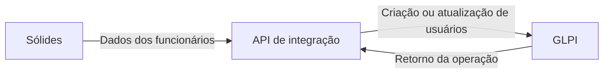
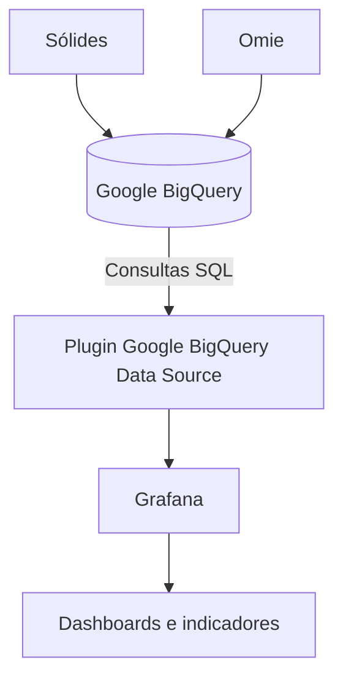

# Ferramentas Infraestrutura

## GLPI

Conector central: Sólides

### Forma de conexão glpi

- **Método de comunicação:** API
- **Autenticação:** Token ou chave de API, conforme o suporte das plataformas.

### Possíveis automatizações

A integração entre o Sólides e o GLPI tem como objetivo automatizar processos relacionados ao cadastro e ao gerenciamento de colaboradores, reduzindo a necessidade de atualizações manuais nos sistemas.

Algumas possibilidades de automação são:

- **Admissão:** quando um funcionário for cadastrado no Sólides, seu usuário poderá ser criado automaticamente no GLPI.
- **Desligamento:** quando um funcionário for desligado no Sólides, seu usuário poderá ser desativado no GLPI.
- **Atualização cadastral:** alterações nos dados do funcionário poderão ser sincronizadas entre os sistemas.

### Dados enviados pelo Sólides

Informações dos funcionários necessárias para realizar as operações no GLPI, como:

- Nome completo;
- E-mail corporativo;
- Departamento;
- Cargo;
- Situação do vínculo empregatício.

### Dados recebidos do GLPI

O retorno dependerá da operação realizada, podendo incluir:

- Confirmação de cadastro ou atualização;
- Identificador do usuário criado;
- Mensagens de erro ou falha na operação.

### Dados armazenados

A definição dependerá da implementação, podendo incluir o histórico das operações e os identificadores necessários para relacionar os usuários dos dois sistemas.

### Fluxo de integração

## Grafana

### Conector central: Google BigQuery

#### Extensão de integração

A comunicação entre o Grafana e o Google BigQuery poderá ser realizada por meio do plugin **Google BigQuery Data Source**, disponibilizado no catálogo oficial do Grafana. O plugin permite consultar os dados armazenados no BigQuery e utilizá-los na criação de dashboards, gráficos e indicadores. [Documentação oficial](https://grafana.com/docs/plugins/grafana-bigquery-datasource/latest/).

### Forma de conexão grafana

- **Plugin:** Google BigQuery Data Source.
- **Fonte de dados:** Google BigQuery.
- **Método de comunicação:** Consultas SQL.
- **Autenticação:** Conta de serviço do Google Cloud ou outro método suportado pelo plugin.
- **Permissões:** Acesso de leitura aos dados e permissão para executar consultas no BigQuery.

### Possíveis funcionalidades

- **Indicadores de RH:** visualizar dados provenientes do Sólides.
- **Indicadores financeiros:** visualizar dados provenientes do Omie.
- **Dashboards gerenciais:** centralizar informações de diferentes áreas.
- **Monitoramento:** acompanhar métricas e indicadores ao longo do tempo.

### Dados consultados

Os dados utilizados dependerão das tabelas e dos conjuntos de dados disponíveis no BigQuery, que recebe informações do Sólides e do Omie.

O Grafana consultará esses dados por meio do plugin, sem necessidade de criar uma integração direta com cada sistema de origem.

### Fluxo de integração grafana

